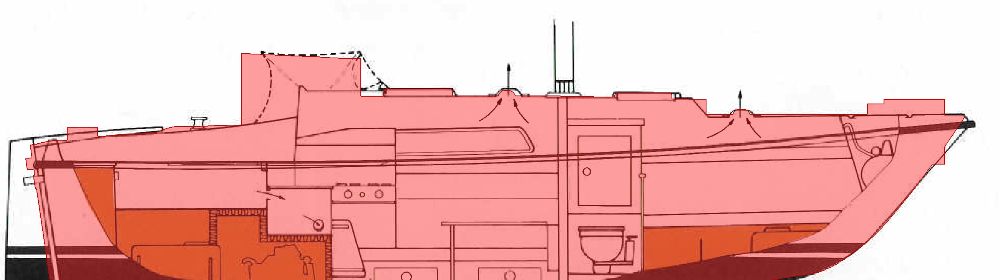
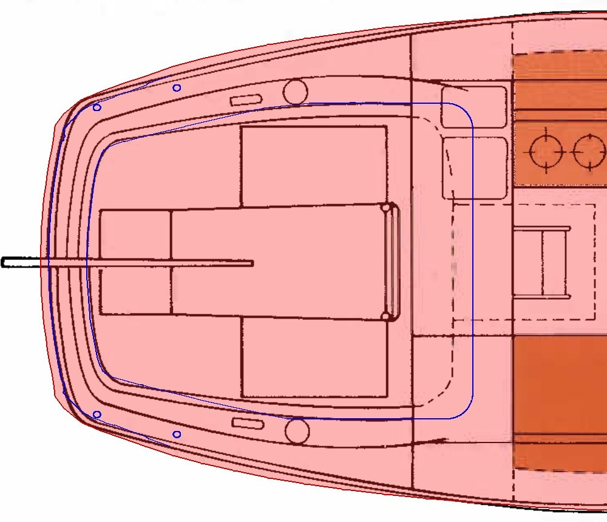
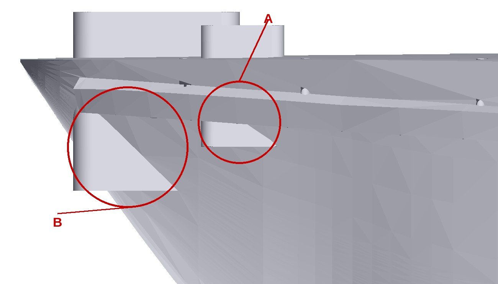
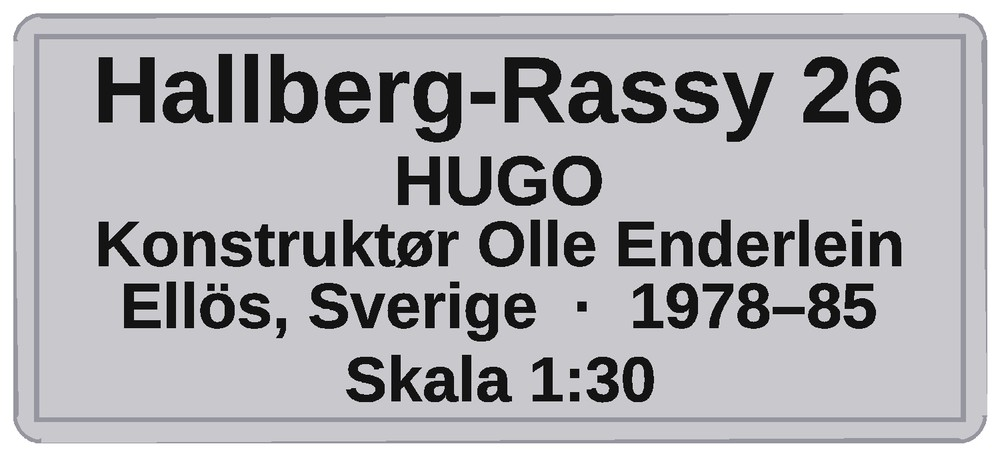

# Eierguide: Hallberg-Rassy 26 «HUGO» i 1:30

En skalamodell av seilbåten Hallberg-Rassy 26, printet i PLA-plast. Denne guiden
forklarer hva den består av, hvordan den henger sammen, og hvordan du maler,
pusser og reparerer den.

## Fakta

- Målestokk 1:30. Lengde 265 mm, bredde 89 mm, mast 354 mm over ruffen
  (12 m i virkeligheten).
- Materiale: PLA. Skroget og ruff-taket printes med glissent fyll (15 %), så
  vekten avhenger av innstillingene. Stativet veier ca. 160 g.
- Skroget er hult forut og akter, har kahytt med innredning midt i, og tar
  rundt ett døgn å printe.

## Delene

- **Skrog:** hele skroget i ett stykke, med dekk, cockpit, kjøl og
  fenderliste. Midt i er kahytten med innredningen fra konstruktørens tegning:
  toalettrom, salong med sofaer og bord, bysse, skap og nedgang. Vinduene i
  skrogsiden er åpne, så man ser inn. Hekken er rundet, med et lett hellende
  akterspeil. Navnet står bare på skiltet.
- **Ruff-tak:** taket på ruffen med luker, ventil og sprayhood, som et eget
  lokk. Løftes det av, ser man ned i kahytten.
- **Ror:** henger bak på akterspeilet. To små tapper sitter i hull under
  vannlinjen.
- **Mast:** en rett stav, 354 mm lang og 4 × 3 mm i tverrsnitt.
- **Mastefot:** lite beslag som limes i hullet på ruff-taket.
- **Masttopp:** hetten øverst på masten.
- **Saling:** to armer som peker bakover og sitter på midten av masten.
- **Bom:** enten bar eller med surret storseil. Ringen i enden går rundt masten.
- **Rekkepåler:** små stolper med øyer for livlinene. Det følger flere med enn
  det som trengs.
- **Bøyemal:** et lite verktøy for å bøye pulpit og pushpit av tråd. Det er ikke
  en del av båten.
- **Stativ:** to vugger og en bjelke som holder båten. Vuggene tres ned på
  tappene på bjelken.
- **Skilt:** plate med navn og data.

## Støtten under skroget

Skroget er printet med støtte (support) under og rundt seg. Den skal fjernes
**svært forsiktig**, i ro og mak:

1. **Start med bunnlaget**, den flate plata som støtten står på. Løsne den først,
   så støtteveggene ikke lenger henger sammen i bunnen.
2. **Løsne deretter støtteveggene én og én**, litt og litt. Bruk fingrene og en
   liten flat tang, og vipp støtten bort fra skroget.
3. **Ikke riv eller trekk i store biter.** Skrogveggen er bare 2 mm tykk.
4. **Rester nærmest skroget** skjæres bort med en skarp kniv, utover og bort fra
   veggen, aldri inn mot den. Til slutt pusses det lett, se «Pusse og
   reparere».

Inne i kahytten er det ingen støtte, og ruff-taket printes uten støtte.

## Slik henger det sammen

Alt limes med superlim (cyanoakrylat). Epoxy fungerer også.

1. Rekkepålene limes i hullene langs dekkskanten, med øynene for-akter. Hullene
   i dekket renses først med et 1,2 mm bor for hånd. **Øynene på pålene må
   bores opp**, se «Rekkepåler og livliner».
2. Pulpit (foran) og pushpit (bak) bøyes av 1,0 mm messingtråd rundt tappene på
   bøyemalen og limes i hullene.
3. Mastefoten limes på ruff-taket. Saling og masttopp tres på masten, og masten
   settes i foten. Masten følger med når taket løftes av.
4. Ruff-taket legges ned over den lave kanten rundt åpningen i dekket. Det
   skal ikke limes. Går det tregt, puss kanten lett med våtpapir.
5. Beslagene på masten er ovale og passer bare på én måte, lang side fore-akter.
6. Roret limes på akterspeilet med tappene i hullene.
7. Livlinene (tynn tråd) tres gjennom øynene på pålene og limes ved pulpit og
   pushpit.

## Rekkepåler og livliner

Hver rekkepåle har to øyne for livlinene, men de er bare 0,5 mm og blir for små
til å være åpne etter printingen. **De må bores opp:**

1. Hold pålen i en liten tang eller trykk den lett mot en kloss av tre.
2. Bor gjennom hvert øye med et **0,5 mm bor i en pinvise** (håndholdt bor).
   Bor for hånd, ikke med maskin, og rett gjennom, vinkelrett på pålen.
3. Rens hullet med bunnen av boret eller en nål, så tråden går lett gjennom.
4. Tre livlinen (0,2–0,3 mm tråd) gjennom øynene, og fest den med en liten dråpe
   superlim.

Pålene er tynne, så bor rolig og støtt dem med fingeren like bak hullet.

## Masten og riggen

- Går masten i stykker, kan du erstatte den med en **3 mm rund stav** i karbon,
  glassfiber eller tre, kappet til 354 mm. Den passer i alle hull og er rettere
  og stivere.
- **Rekkepåler** kan også lages av 1,0 mm messingtråd, klippet i biter på
  ca. 22 mm.
- **Kobbertråd** er et alternativ til messing for pulpit, pushpit og livliner.
  Den er myk og lett å bøye for hånd, og den kan males. Bruk 0,3–0,5 mm til
  livliner. Kobber er mykere enn messing, så rekkene kan bli skjeve ved
  håndtering.
- Stag og vant er 0,2–0,3 mm tråd, limt med superlim.

## Maling

Fargene på skroget (rød bunn, hvit stripe, sort stripe, hvitt over) er printet
inn og ikke malt. Resten kan males hvis du vil, med akrylmaling for
modellbygging (f.eks. Vallejo eller Tamiya).

1. **Pusse lett** med våtpapir 400. PLA blir gummiaktig av tørrpussing, så bruk
   vann.
2. **Grunne** med to tynne strøk grunning i spray. Det fyller laglinjene og gir
   bedre feste.
3. **Male** i tynne strøk, og la hvert strøk tørke.
4. **Klarlakk** i matt eller silke til slutt. Test på et skjult sted først.
   Sterke løsemidler (aceton, cellulosefortynner) kan skade PLA.

Ideer til maling:

- **Fenderlisten** langs skrogsiden i sort.
- **Vinduene** i skrogsiden er åpne. Vil du ha «glass», lim tynn, tonet
  plastfolie på innsiden før taket settes på.
- **Innredningen** kan males før taket settes på, for eksempel trefarge på
  durk, køyer og bord.
- **Sprayhooden** over nedgangen i blått, som på originalen.
- **Kanten i vuggene**, der skroget ligger, kan tegnes sort med tusj, så ser den
  ut som gummilist.

## Pusse og reparere

- **Skrogveggen er tynn:** 2 mm. Slip aldri mer enn ca. 0,3 mm, ellers kommer
  du gjennom.
- **Broen over vinduene:** sidedekket over de åpne vinduene spenner ca. 42 mm.
  Henger den litt, kan undersiden files rett gjennom vindusåpningen.
- **Støttemerker** under skroget: fil først, så våtpapir 240 og 400.
- **Laglinjer:** grunning og tynne lag spartel, så våtpapir 400 til 600.
- **Små mangler:** superlim blandet med natron (bakepulver) gir rask fyll som kan
  pusses etter et par minutter.
- **Større hull eller sprekker:** epoxyspartel (f.eks. Milliput), pusses neste
  dag.
- **Sprukne deler:** limes med superlim, og hold dem sammen i et minutt.
- **Varme:** PLA myknes ved ca. 55–60 °C. Ikke la modellen stå i en varm bil, i
  sol bak glass eller ved en radiator.
- **Vann:** skroget er hult og ikke tett, så det skal ikke ut på vannet.

## Verktøy

Superlim, epoxy, våtpapir (240, 400, 600), fil, kniv, pinsett, flattang,
akrylmaling og pensler, grunning i spray, klarlakk, 1,0 mm messingtråd, tynn tråd
til livliner, pinvise med 0,5 mm bor (øyene på pålene) og et 1,2 mm bor
(hullene i dekket).

## Det modellen ikke har

- Cockpiten er forenklet, uten benker eller brodekk, og karmen går ikke rundt
  hekken.
- Kahytten slutter ved 5,6 m, der cockpiten begynner i modellen. Vask, isboks
  og motorkasse akterst i kahytten er ikke med.
- Skrogformen under vann akter er ikke endelig. Tegningen, deplasementet og
  bildene er ikke enige, og et mål fra båten skal avgjøre det.
- Roret er bare bladet under vannlinjen, uten rorhode.
- Mastens tykkelse er et anslag og ikke et målt mål.
- Vinduets forkant er skrå som på tegningene; på bildene ser den avrundet ut.

# Innsikt: slik ble modellen til

Modellen er tegnet fra bunnen av i et parametrisk program. Hvert mål er et tall som kan endres, og hele båten bygges på nytt fra tallene. Utgangspunktet var bilder av båten og tegninger i en gammel brosjyre: profil og dekksplan i 1:50 og seilplan i 1:100. Tegningene er brukt som hjelpemidler. Hver kurve er sporet piksel for piksel og kalibrert mot lengden på 7,95 m.

## Hva som er målt og hva som er tolket

| Målt fra tegning | Tolket eller anslått |
|---|---|
| Lengde, bredde, dypgang og vannlinje | Tverrsnittene i skroget |
| Profil: stevn, kjøl, rorets form | Mastens tykkelse (4 × 3 mm, anslag) |
| Dekkskant, fenderliste og rundet hekk | Rekkepålenes tykkelse |
| Ruff, luker, cockpit og vindu | Sprayhooden (høyde målt, formen forenklet) |

Målene stemte godt over kors. Den målte bredden ble 0,7 % fra oppgitt, og dypgangen 0,6 %. Det viste at de to tegningene er i samme målestokk, og at kalibreringen var riktig.

## Valgene vi måtte ta

**1. Ingen spanteriss.** Brosjyren har profil og dekksplan, men ikke spantene, altså tverrsnittene. Vi laget dem selv: nedenfor vannlinjen en superellipse som blir fyldigere og flatere midtskips, og over vannlinjen en jevn utfalling opp til dekkskanten. Formen mellom stasjonene er en rekonstruksjon, ikke en fasit.

**2. Dekkskanten sto for lavt.** Først ble dekkskanten lagt på fenderlisten, fordi det så ut som den øverste linjen. Det ga et for lavt skrog, og vinduet havnet oppe i ruffen. Tegningen og bilder viser at skrogsiden fortsetter 130 til 280 mm over listen, opp til en tynn linje der rekka står. Vi flyttet dekkskanten dit, og listen ble en list utenpå skroget.

**3. Vinduet.** Langvinduet sitter i skrogsiden, i en fortsettelse av siden, ikke trukket inn i ruffen. Det ligger mellom listen og dekkskanten, så det skråner med båten. Først var det 1 200 mm langt og forsenket en halv millimeter. I versjon 10 er det en åpning inn til kahytten, 1 680 mm lang og skrå i begge ender, slik Enderleins tegning, seilplanen og katalogen fra 1981 viser.

**4. Hekken.** Sporingen leste hjørnene i dekksplanen som en spiss. Men hekken er rundet i plan, og akterspeilet heller 8,3° med toppen lengst akter. Vi rettet det: skroget er rundet, akterspeilet hellende og svakt buet, og cockpitbrønnen følger hekkens kurve helt bak. Roret henger nå riktig på akterspeilet. Før bommet tappene.

**5. Et hull i stevnen.** Skroget er hult, og i den smale baugkilen ble innsiden først laget som en forminsket kopi av ytterformen. Veggen ble da bare 0,2 til 0,5 mm tykk, og hulrommet gikk gjennom stevnen ved vannlinjen. Innsiden er nå ekte forskjøvet innover langs normalen, med en liten margin. I versjon 10 er veggen 2 mm.

**6. Et hult skrog som bærer seg selv.** Skroget er hult for å spare plast og vekt. Innvendige spant hver 26 mm bærer dekket, som spenner mellom dem som en bro. Cockpitgulv, mastesokkel og vindusvegg er spart som massive partier.

**7. Det som er for tynt.** I 1:30 blir 1 mm til 30 mm. Rekkepålene er 1,1 mm tykke, som er 33 mm i virkeligheten, mot ca. 25 mm på en ekte påle. De er litt for grove, men tynnere ville ikke latt seg lage. Øynene for livlinene er 0,5 mm, og må bores opp for hånd.

**8. Feil som ble funnet underveis.** Salingen hadde armene 90° feil mot hullet, og passet ikke på masten. Stativbjelkens klosser hang over en utsparing uten feste. Begge ble oppdaget ved montering og rettet.

**9. Beslagene i baugen stikker ut.** Ankerrullen og de to fortøyningsklampene i baugen er laget som klosser som går ned i skroget under dekket. I den smale baugen kommer de ut gjennom skrogsiden og stevnen: en kloss på hver side (A) og en foran i stevnen (B). Dette ble oppdaget etter at modellen var ferdig. I versjon 10 er beslagene laget på nytt: hornklampene og stevnbeslaget med ankerrullen står på dekket og holder seg innenfor dekkskanten.

**10. Deplasementet stemmer ikke.** Modellen har et beregnet undervannsvolum på rundt 3,4 m³, mens Enderleins tegning oppgir 2,36 m³ med en jernkjøl på 1 100 kg. Skrogformen under vann er tolket, og et bilde akterfra tyder også på at den er for fyldig akter. En strekprikket linje på tegningen, trolig en vannlinje ved durken, passer derimot med dagens form. Et mål fra båten skal avgjøre det.

**11. Farger.** Vannlinjen er et vannrett plan, så bunnstoffet og den lyse stripen kan legges inn som farger i lagene. Fenderlisten og dekkskanten stiger mot baugen og følger ikke noe plan, så de lar seg ikke farge slik og må males.

**12. Skiltet.** Skriften på skiltet måtte være tykk nok. Tynne streker kan ikke lages i en så liten målestokk, så vi valgte en fet skrifttype og færre linjer.

**13. Versjon 10: konstruktørens egen tegning.** Etter hvert fant vi Enderleins tegning 448-5 i 1:15 fra 1977, med profil og plan med innredning. Den viste at kjølen var mye større enn i modellen: forkanten står 400–650 mm lenger forut, bakkanten er nesten loddrett, og bunnen er flat med et stort rundet hjørne foran. Kjølen er nå tegnet etter hans linjer og gjort 240 mm tykk, slik bildene viser.

**14. Et avtakbart tak og en kahytt.** Taket på ruffen ble et eget lokk, så kahytten kan vises. Innredningen er hentet fra tegningen og printes i skroget uten støtte: alle tak inne i kahytten heller 45°, og durk, køyer og skap står på fyllet under seg. Lokket står på en plan skjøt litt over dekket og printes flatt på den, også uten støtte. Et spor i undersiden går ned over en lav kant rundt åpningen i dekket.

**15. Glattere linjer.** Dekkskanten var 16 rette stykker, og kurvene hadde knekk i hvert målepunkt. I versjon 10 er linjene glatte kurver, eksporten har fast toleranse, fenderlisten er slankere og hjørnene på akterspeilet er avrundet. Andelen knekker over 5° i skrogflaten gikk fra 17 % til under 1 %.

## Verftet, konstruktøren og båten

**Verftet.** Harry Hallberg (1914–1997) begynte å bygge trebåter som 14-åring og startet eget verft i Kungsviken på Orust i 1943, midt under krigsårene. Hans første serieproduserte båt var Folkbåten, og han hadde stor suksess med Kungskryssaren. Han var tidlig ute med glassfiber og serieproduksjon av seilbåter fra 1963. På 1960-tallet flyttet han til et større anlegg i Ellös, ti kilometer unna.

**Christoph Rassy.** Rassy ble født i 1934 i Bayern, ved Starnberger See, og lærte å bygge trebåter ved et lite verft i Sør-Tyskland. I 1960 flyttet han til Sverige med sykkelen som eneste eiendel. Han overtok senere Hallbergs gamle verft i Kungsviken. Da Hallberg trakk seg tilbake i 1972, ble navnene slått sammen til Hallberg-Rassy, med verftet i Ellös. Rassy ledet det til 2003, da sønnen Magnus overtok.

**Konstruktøren.** Olle Enderlein (1917–1993) vokste opp i Norrköping og utdannet seg til ingeniør. Som 27-åring forlot han motorprodusenten Archimedes for å konstruere båter på heltid. Ifølge én kilde, som jeg ikke har fått bekreftet andre steder, vant han i 1944 førstepremien i Svenska Kryssarklubbens konkurranse om en seilbåtkonstruksjon, med forslaget «Gudingen». Fra slutten av 1960-årene til begynnelsen av 1980-årene tegnet han nesten alle Hallberg-Rassys modeller, blant dem Rasmus 35, som var Rassys første serieproduserte båt. Andre kjente konstruksjoner er OE 36 og Shipman 28. Kildene oppgir fra rundt hundre til over to hundre konstruksjoner. Tegningene hans er bevart i arkivet til Sjöhistoriska museet i Stockholm, og museet har gitt ut en bok om ham av Ingrid Kaiser (2002).

**Hallberg-Rassy 26.** Båten ble tegnet av Enderlein og bygget fra 1978 til 1985, 469 stykker. I 1978 fikk den prisen «Golden Steering Wheel» fra bladet Båtnytt, som en familiebåt bygget til høy standard. I dag bygger verftet i Ellös seilyachter på 34 til 69 fot.

Mer å lese: verftets egne sider (hallberg-rassy.com, «Company history») og Sjöhistoriska museets samling på DigitaltMuseum (søk «Olle Enderlein»).

## Hvor mye arbeid lå bak

Modellen er laget i en lang dialog med en AI (Claude fra Anthropic), som skrev programmet og regnet på tegningene. En token er en bit tekst på omtrent fire tegn. Fordi dialogen er så lang, leses det som allerede er sagt inn på nytt i hver runde, og det er den største posten. Tallene er hentet fra bruksrapporten per 12. oktober.

| | Omtrent |
|---|---|
| Lest på nytt fra mellomlager | 46 millioner tokens |
| Skrevet til mellomlager | 1,7 millioner tokens |
| Direkte inn og ut | 6 000 tokens |
| Beregnet etter API-priser | ca. 200 dollar, ca. 2 000 kr per 12. oktober |

## Det modellen ikke er

Den er en utstillingsmodell, ikke en nøyaktig kopi. Skrogformen mellom målepunktene er tolket. Cockpiten er forenklet, og roret er bare bladet under vannlinjen.
