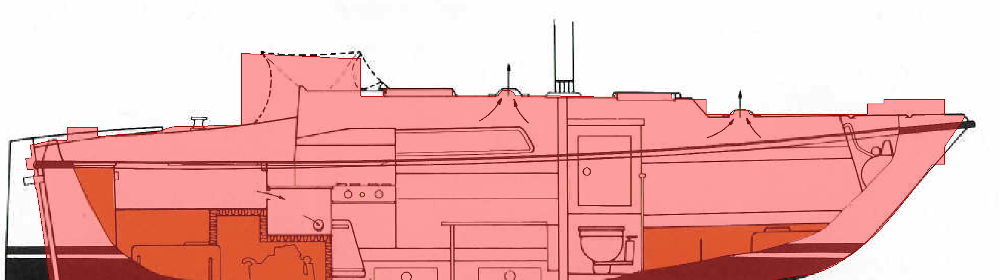
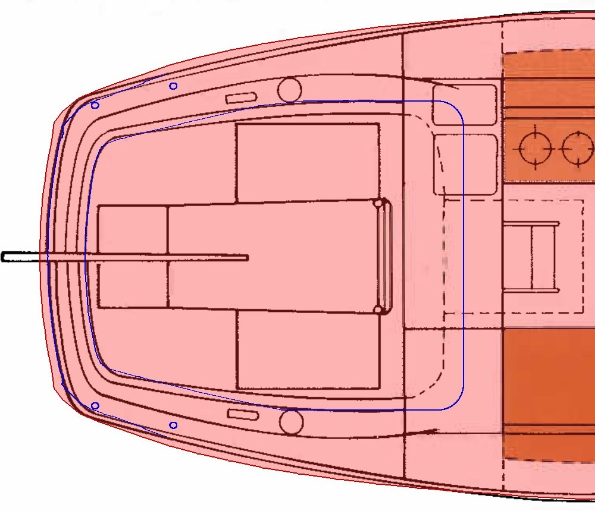
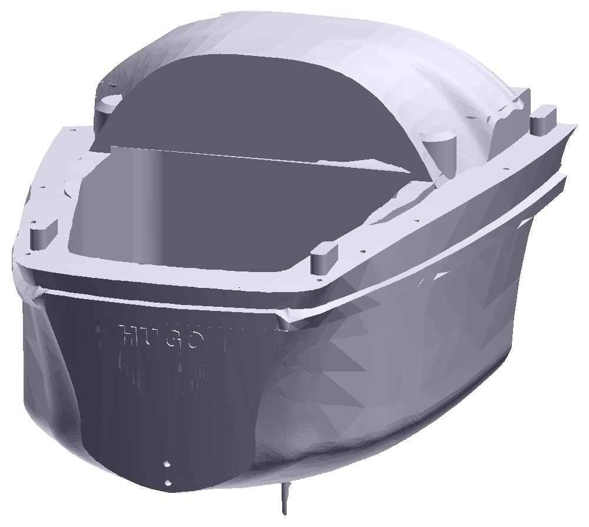
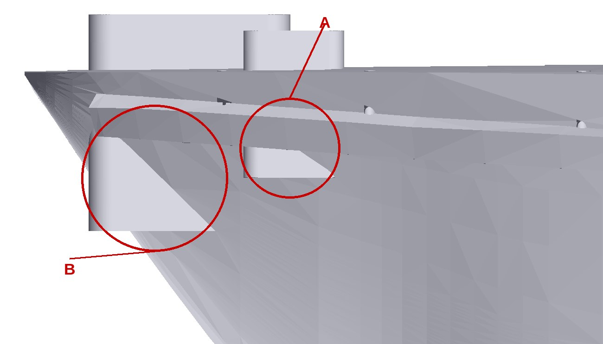
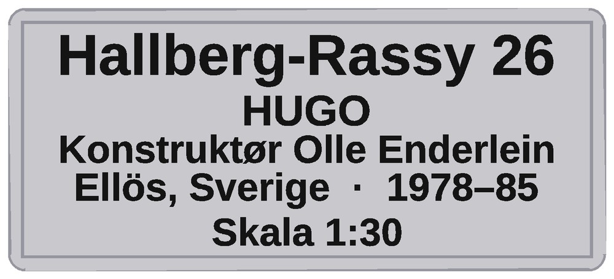

# Eierguide: Hallberg-Rassy 26 «HUGO» i 1:30

En skalamodell av seilbåten Hallberg-Rassy 26, printet i PLA-plast. Denne guiden
forklarer hva den består av, hvordan den henger sammen, og hvordan du maler,
pusser og reparerer den.

## Fakta

- Målestokk 1:30. Lengde 265 mm, bredde 89 mm, mast 354 mm over ruffen
  (12 m i virkeligheten).
- Materiale: PLA. Hele modellen veier ca. 470 g, og skroget alene ca. 280 g.
- Skroget er hult og tar rundt ett døgn å printe.

## Delene

- **Skrog:** hele skroget i ett stykke, med ruff, cockpit, kjøl, vinduer og
  fenderliste. Hekken er rundet, med et lett hellende akterspeil som har navnet
  HUGO i relieff.
- **Ror:** henger bak på akterspeilet. To små tapper sitter i hull under
  vannlinjen.
- **Mast:** en rett stav, 354 mm lang og 4 × 3 mm i tverrsnitt.
- **Mastefot:** lite beslag som limes i hullet i ruffen.
- **Masttopp:** hetten øverst på masten.
- **Saling:** to armer som peker bakover og sitter på midten av masten.
- **Bom:** enten bar eller med surret storseil. Ringen i enden går rundt masten.
- **Rekkepåler:** små stolper med øyer for livlinene. Det følger flere med enn
  det som trengs.
- **Bøyemal:** et lite verktøy for å bøye pulpit og pushpit av tråd. Det er ikke
  en del av båten.
- **Stativ:** to vugger og en bjelke som holder båten. Vuggene tres ned på
  tappene på bjelken.
- **Skilt:** plate med navn og data.

## Støtten under skroget

Skroget er printet med støtte (support) under og rundt seg. Den skal fjernes
**svært forsiktig**, i ro og mak:

1. **Start med bunnlaget**, den flate plata som støtten står på. Løsne den først,
   så støtteveggene ikke lenger henger sammen i bunnen.
2. **Løsne deretter støtteveggene én og én**, litt og litt. Bruk fingrene og en
   liten flat tang, og vipp støtten bort fra skroget.
3. **Ikke riv eller trekk i store biter.** Skrogveggen er bare 1,5 mm tykk.
4. **Rester nærmest skroget** skjæres bort med en skarp kniv, utover og bort fra
   veggen, aldri inn mot den. Til slutt pusses det lett, se «Pusse og
   reparere».

## Slik henger det sammen

Alt limes med superlim (cyanoakrylat). Epoxy fungerer også.

1. Rekkepålene limes i hullene langs dekkskanten, med øynene for-akter. Hullene
   i dekket renses først med et 1,2 mm bor for hånd. **Øynene på pålene må
   bores opp**, se «Rekkepåler og livliner».
2. Pulpit (foran) og pushpit (bak) bøyes av 1,0 mm messingtråd rundt tappene på
   bøyemalen og limes i hullene.
3. Mastefoten limes i ruffen. Saling og masttopp tres på masten, og masten
   settes i foten.
4. Beslagene på masten er ovale og passer bare på én måte, lang side fore-akter.
5. Roret limes på akterspeilet med tappene i hullene.
6. Livlinene (tynn tråd) tres gjennom øynene på pålene og limes ved pulpit og
   pushpit.

## Rekkepåler og livliner

Hver rekkepåle har to øyne for livlinene, men de er bare 0,5 mm og blir for små
til å være åpne etter printingen. **De må bores opp:**

1. Hold pålen i en liten tang eller trykk den lett mot en kloss av tre.
2. Bor gjennom hvert øye med et **0,5 mm bor i en pinvise** (håndholdt bor).
   Bor for hånd, ikke med maskin, og rett gjennom, vinkelrett på pålen.
3. Rens hullet med bunnen av boret eller en nål, så tråden går lett gjennom.
4. Tre livlinen (0,2–0,3 mm tråd) gjennom øynene, og fest den med en liten dråpe
   superlim.

Pålene er tynne, så bor rolig og støtt dem med fingeren like bak hullet.

## Masten og riggen

- Går masten i stykker, kan du erstatte den med en **3 mm rund stav** i karbon,
  glassfiber eller tre, kappet til 354 mm. Den passer i alle hull og er rettere
  og stivere.
- **Rekkepåler** kan også lages av 1,0 mm messingtråd, klippet i biter på
  ca. 22 mm.
- **Kobbertråd** er et alternativ til messing for pulpit, pushpit og livliner.
  Den er myk og lett å bøye for hånd, og den kan males. Bruk 0,3–0,5 mm til
  livliner. Kobber er mykere enn messing, så rekkene kan bli skjeve ved
  håndtering.
- Stag og vant er 0,2–0,3 mm tråd, limt med superlim.

## Maling

Fargene på skroget (rød bunn, hvit stripe, sort stripe, hvitt over) er printet
inn og ikke malt. Resten kan males hvis du vil, med akrylmaling for
modellbygging (f.eks. Vallejo eller Tamiya).

1. **Pusse lett** med våtpapir 400. PLA blir gummiaktig av tørrpussing, så bruk
   vann.
2. **Grunne** med to tynne strøk grunning i spray. Det fyller laglinjene og gir
   bedre feste.
3. **Male** i tynne strøk, og la hvert strøk tørke.
4. **Klarlakk** i matt eller silke til slutt. Test på et skjult sted først.
   Sterke løsemidler (aceton, cellulosefortynner) kan skade PLA.

Ideer til maling:

- **Fenderlisten** langs skrogsiden i sort.
- **Vinduene** i skrogsiden i mørk grå eller sort.
- **Sprayhooden** over nedgangen i blått, som på originalen.
- **Navnet HUGO** med fin pensel.
- **Kanten i vuggene**, der skroget ligger, kan tegnes sort med tusj, så ser den
  ut som gummilist.

## Pusse og reparere

- **Skrogveggen er tynn:** 1,5 mm som minst. Slip aldri mer enn ca. 0,3 mm,
  ellers kommer du gjennom.
- **Klampene og ankerrullen i baugen stikker gjennom skroget.** De er laget som
  klosser som går ned under dekket, og i den smale baugen kommer de ut gjennom
  skrogsiden og stevnen (se bildet i Innsikt-kapitlet). De kan files ned til
  skrogflaten: legg maskeringstape rundt, fil flatt mot skroget, og stopp når
  flaten er jevn. Gå ikke dypere. Veggen bak er minst 1,3 mm tykk, så det blir
  ikke hull. Skulle det likevel komme et lite hull, lapper du det med superlim og
  natron eller epoxyspartel, og pusser med 240 og 400.
- **Støttemerker** under skroget: fil først, så våtpapir 240 og 400.
- **Laglinjer:** grunning og tynne lag spartel, så våtpapir 400 til 600.
- **Små mangler:** superlim blandet med natron (bakepulver) gir rask fyll som kan
  pusses etter et par minutter.
- **Større hull eller sprekker:** epoxyspartel (f.eks. Milliput), pusses neste
  dag.
- **Sprukne deler:** limes med superlim, og hold dem sammen i et minutt.
- **Varme:** PLA myknes ved ca. 55–60 °C. Ikke la modellen stå i en varm bil, i
  sol bak glass eller ved en radiator.
- **Vann:** skroget er hult og ikke tett, så det skal ikke ut på vannet.

## Verktøy

Superlim, epoxy, våtpapir (240, 400, 600), fil, kniv, pinsett, flattang,
akrylmaling og pensler, grunning i spray, klarlakk, 1,0 mm messingtråd, tynn tråd
til livliner, pinvise med 0,5 mm bor (øyene på pålene) og et 1,2 mm bor
(hullene i dekket).

## Det modellen ikke har

- Cockpiten er forenklet, uten benker eller brodekk, og karmen går ikke rundt
  hekken.
- Klampene og ankerrullen i baugen stikker gjennom skroget og kan pusses ned,
  se «Pusse og reparere».
- Roret er bare bladet under vannlinjen, uten rorhode.
- Mastens tykkelse er et anslag og ikke et målt mål.
- Vinduet i skrogsiden er litt for langt akterover, ca. 2 mm i modellen.

# Innsikt: slik ble modellen til

Modellen er tegnet fra bunnen av i et parametrisk program. Hvert mål er et tall som kan endres, og hele båten bygges på nytt fra tallene. Utgangspunktet var bilder av båten og tegninger i en gammel brosjyre: profil og dekksplan i 1:50 og seilplan i 1:100. Tegningene er brukt som hjelpemidler. Hver kurve er sporet piksel for piksel og kalibrert mot lengden på 7,95 m.

## Hva som er målt og hva som er tolket

| Målt fra tegning | Tolket eller anslått |
|---|---|
| Lengde, bredde, dypgang og vannlinje | Tverrsnittene i skroget |
| Profil: stevn, kjøl, rorets form | Mastens tykkelse (4 × 3 mm, anslag) |
| Dekkskant, fenderliste og rundet hekk | Rekkepålenes tykkelse |
| Ruff, luker, cockpit og vindu | Sprayhooden (høyde målt, formen forenklet) |

Målene stemte godt over kors. Den målte bredden ble 0,7 % fra oppgitt, og dypgangen 0,6 %. Det viste at de to tegningene er i samme målestokk, og at kalibreringen var riktig.

## Valgene vi måtte ta

**1. Ingen spanteriss.** Brosjyren har profil og dekksplan, men ikke spantene, altså tverrsnittene. Vi laget dem selv: nedenfor vannlinjen en superellipse som blir fyldigere og flatere midtskips, og over vannlinjen en jevn utfalling opp til dekkskanten. Formen mellom stasjonene er en rekonstruksjon, ikke en fasit.

**2. Dekkskanten sto for lavt.** Først ble dekkskanten lagt på fenderlisten, fordi det så ut som den øverste linjen. Det ga et for lavt skrog, og vinduet havnet oppe i ruffen. Tegningen og bilder viser at skrogsiden fortsetter 130 til 280 mm over listen, opp til en tynn linje der rekka står. Vi flyttet dekkskanten dit, og listen ble en list utenpå skroget.

**3. Vinduet.** Langvinduet sitter i skrogsiden, i en fortsettelse av siden, ikke trukket inn i ruffen. Det er 1 200 mm langt og ligger mellom listen og dekkskanten. Underkant og overkant følger de to linjene, så vinduet skråner med båten. Det er forsenket 15 mm, altså en halv millimeter i 1:30.

**4. Hekken.** Sporingen leste hjørnene i dekksplanen som en spiss. Men hekken er rundet i plan, og akterspeilet heller 8,3° med toppen lengst akter. Vi rettet det: skroget er rundet, akterspeilet hellende og svakt buet, og cockpitbrønnen følger hekkens kurve helt bak. Roret henger nå riktig på akterspeilet. Før bommet tappene.

**5. Et hull i stevnen.** Skroget er hult, og i den smale baugkilen ble innsiden først laget som en forminsket kopi av ytterformen. Veggen ble da bare 0,2 til 0,5 mm tykk, og hulrommet gikk gjennom stevnen ved vannlinjen. Innsiden er nå ekte forskjøvet innover langs normalen, med en liten margin. Veggen er minst 1,5 mm overalt, og 3,4 mm i baugen.

**6. Et hult skrog som bærer seg selv.** Skroget er hult for å spare plast og vekt. Innvendige spant hver 26 mm bærer dekket, som spenner mellom dem som en bro. Cockpitgulv, mastesokkel og vindusvegg er spart som massive partier.

**7. Det som er for tynt.** I 1:30 blir 1 mm til 30 mm. Rekkepålene er 1,1 mm tykke, som er 33 mm i virkeligheten, mot ca. 25 mm på en ekte påle. De er litt for grove, men tynnere ville ikke latt seg lage. Øynene for livlinene er 0,5 mm, og må bores opp for hånd.

**8. Feil som ble funnet underveis.** Salingen hadde armene 90° feil mot hullet, og passet ikke på masten. Stativbjelkens klosser hang over en utsparing uten feste. Begge ble oppdaget ved montering og rettet.

**9. Beslagene i baugen stikker ut.** Ankerrullen og de to fortøyningsklampene i baugen er laget som klosser som går ned i skroget under dekket. I den smale baugen kommer de ut gjennom skrogsiden og stevnen: en kloss på hver side (A) og en foran i stevnen (B). Dette ble oppdaget etter at modellen var ferdig, og er ikke rettet. De kan pusses ned til skrogflaten. Ved kontroll er veggen bak minst 1,3 mm tykk, så det blir ikke hull. Se «Pusse og reparere».

**10. Deplasementet stemmer ikke.** Modellen har et beregnet undervannsvolum på 3,9 m³, mens brosjyren oppgir 2,5 tonn. Avviket skyldes den forholdsvis flate kanobunnen i tegningen. Formen er hentet fra tegningen, så tallet er ikke egnet til hydrostatikk.

**11. Farger.** Vannlinjen er et vannrett plan, så bunnstoffet og den lyse stripen kan legges inn som farger i lagene. Fenderlisten og dekkskanten stiger mot baugen og følger ikke noe plan, så de lar seg ikke farge slik og må males.

**12. Skiltet.** Skriften på skiltet måtte være tykk nok. Tynne streker kan ikke lages i en så liten målestokk, så vi valgte en fet skrifttype og færre linjer.

## Hvor mye arbeid lå bak

Modellen er laget i en lang dialog med en AI (Claude fra Anthropic), som skrev programmet og regnet på tegningene. En token er en bit tekst på omtrent fire tegn. Fordi dialogen er så lang, leses det som allerede er sagt inn på nytt i hver runde, og det er den største posten. Tallene er hentet fra bruksrapporten per 12. oktober, og arbeidet etter det (skiltet, bjelken og denne guiden) kommer i tillegg.

| | Omtrent |
|---|---|
| Lest på nytt fra mellomlager | 46 millioner tokens |
| Skrevet til mellomlager | 1,7 millioner tokens |
| Direkte inn og ut | 6 000 tokens |
| Beregnet etter API-priser | ca. 200 dollar, ca. 2 000 kr per 12. oktober |
| Anslag for alt arbeid til nå | 200 til 230 dollar, ca. 2 000 til 2 400 kr |

## Det modellen ikke er

Den er en utstillingsmodell, ikke en nøyaktig kopi. Skrogformen mellom målepunktene er tolket. Cockpiten er forenklet, og roret er bare bladet under vannlinjen. Vinduet er ca. 2 mm for langt akterover i modellen.
